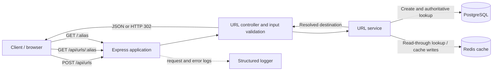

# URL Shortener: Requirements and Architecture

## 1. Purpose and scope

This service accepts an HTTP(S) URL and returns a short link. Opening the short
link redirects the caller to the original URL. PostgreSQL is the source of
truth; Redis is an optional read-through cache.

This document describes behavior implemented in the repository. Items marked
**Not specified** are product or operational targets that need agreement; they
are not guarantees made by the current implementation.

## 2. Functional requirements

| ID | Requirement | Current behavior |
| --- | --- | --- |
| FR-1 | Create a short link for a destination URL. | `POST /api/urls` accepts an HTTP or HTTPS URL and returns `201` with the alias, original URL, short URL, creation time, and optional expiry. |
| FR-2 | Allow callers to request a custom alias. | Optional `alias` must contain 3–32 characters from `[0-9a-zA-Z_-]`. Aliases are unique. `api` and `health` are reserved, case-insensitively. |
| FR-3 | Generate an alias when none is supplied. | A keyed HMAC of the normalized URL and a salt is encoded as a 6- or 7-character Base62 code. The secret and length are configuration values. |
| FR-4 | Return the same generated link for a repeated equivalent request where possible. | Generated aliases are deterministic for a URL, secret, and salt. A repeated mapping with the same expiry returns the existing record. A mapping with a different expiry is distinct. |
| FR-5 | Resolve a short link to its stored destination. | `GET /api/urls/:alias` returns the link details as JSON. |
| FR-6 | Redirect a short link to its destination. | `GET /:alias` responds with HTTP `302` and the original URL in the `Location` header. |
| FR-7 | Support expiring links. | Optional `expiresAt` must be a valid future date when created. Resolution returns `410 Gone` after expiry. |
| FR-8 | Reject malformed or unsupported input. | Request body is limited to 10 KB. URL length is limited to 2,048 characters; only HTTP(S) schemes are accepted. Invalid input returns `400`. |
| FR-9 | Report service and dependency health. | `GET /health` checks PostgreSQL and reports Redis status. PostgreSQL failure returns `503`; Redis unavailable with PostgreSQL healthy reports `degraded`. |
| FR-10 | Provide consistent error responses. | Validation, conflict, missing-link, expired-link, malformed-JSON, and unexpected errors are mapped to HTTP responses by shared middleware. |

### HTTP interface

#### `POST /api/urls`

Request:

```json
{
  "url": "https://example.com/path",
  "alias": "my-link",
  "expiresAt": "2030-01-01T00:00:00.000Z"
}
```

`alias` and `expiresAt` are optional. The response is `201 Created`:

```json
{
  "alias": "my-link",
  "originalUrl": "https://example.com/path",
  "shortUrl": "https://short.example/my-link",
  "expiresAt": "2030-01-01T00:00:00.000Z",
  "createdAt": "2026-10-24T00:00:00.000Z"
}
```

`shortUrl` uses configured `BASE_URL` when set; otherwise it is built from the
request protocol and host.

#### `GET /api/urls/:alias`

Returns the same link fields as the creation response. A missing alias returns
`404`; an expired link returns `410`.

#### `GET /:alias`

Redirects to the original URL with `302`. A missing alias returns `404`; an
expired link returns `410`.

#### Error status summary

| Status | Meaning |
| --- | --- |
| `400` | Invalid request fields or malformed JSON |
| `404` | Alias or route not found |
| `409` | Custom alias is reserved or already exists |
| `410` | Link has expired |
| `503` | Generated code could not be allocated after collision retries, or health check found PostgreSQL unavailable |
| `500` | Unexpected server error |

## 3. Non-functional requirements

The repository does not define numeric service-level objectives. The following
records the current design and where a measurable target remains to be set.

| Concern | Requirement / intent | Current implementation and limits |
| --- | --- | --- |
| Availability | Keep link resolution available during cache outages. | Redis is optional for request handling; cache read/write failures are logged and resolution falls back to PostgreSQL. PostgreSQL remains required. |
| Durability | Persist mappings independently from the cache. | PostgreSQL stores mappings. Redis entries are disposable and have a configurable TTL. |
| Performance | Keep frequent redirects off the database when possible. | Redis caches positive resolutions for up to `CACHE_TTL_SECONDS` (default 86,400 seconds) and missing aliases for `CACHE_MISS_TTL_SECONDS` (default 60 seconds). No latency or throughput target is specified. |
| Scalability | Allow multiple application instances to serve requests. | The HTTP application is stateless between requests; shared PostgreSQL and Redis provide storage/cache. PostgreSQL pool size is configurable. No tested capacity or autoscaling policy is specified. |
| Security | Reduce common HTTP and input-handling risks. | Helmet is enabled, Express's `X-Powered-By` header is disabled, JSON bodies are capped, and destination URLs are restricted to HTTP(S). HMAC short-code generation uses a configured secret of at least 32 characters. |
| Access control and abuse prevention | Define who may create links and how creation is protected. | **Not implemented / not specified:** authentication, ownership, authorization, rate limiting, quotas, and abuse reporting. |
| Reliability | Avoid overwriting links and handle generated-code collisions. | Alias is the PostgreSQL primary key; inserts surface uniqueness conflicts. Generated aliases retry with up to five salts before returning `503`. |
| Operability | Make service state and failures observable. | `/health` checks dependencies; Pino emits structured HTTP/application logs and redacts authorization and cookie headers. Metrics, tracing, alerting, and log-retention targets are not specified. |
| Maintainability | Keep schema changes explicit and configuration validated. | TypeORM migrations are used with schema synchronization disabled. Environment variables are validated at startup. |
| Portability | Support a long-running server and serverless HTTP execution. | `src/index.ts` starts Express directly; `src/lambda.ts` adapts the same app with `serverless-http` and reuses initialized connections during warm invocations. |
| Data lifecycle | Define cleanup and retention for links and expired records. | **Not specified:** expired rows are not automatically deleted; they remain in PostgreSQL and resolve as `410`. |

## 4. High-level architecture (HLA)



### Components

| Component | Responsibility |
| --- | --- |
| Express application | Configures HTTP middleware, health endpoint, API and redirect routes, and centralized error handling. |
| URL controller | Parses and validates request data, invokes the service, formats response URLs, and issues redirects. |
| URL service | Normalizes destinations, generates or accepts aliases, persists records, resolves aliases, and enforces expiry at read time. |
| PostgreSQL | Authoritative store for aliases, destinations, expiry, and creation timestamps. |
| Redis | Best-effort cache for positive and negative alias lookups; cache errors fall back to PostgreSQL. |
| Lambda adapter | Wraps the same Express application for AWS Lambda and initializes dependencies lazily so warm invocations can reuse them. |

### Main request flows

**Create:** Validate the JSON body, normalize the destination URL, allocate an
alias (or validate the requested alias), insert the mapping into PostgreSQL,
and best-effort populate Redis. A generated-code collision with another
mapping retries using the next salt.

**Resolve or redirect:** Check Redis first. On a cache miss, query PostgreSQL
and asynchronously populate either a positive cache entry or a short-lived
negative entry. Return link details or issue a `302` redirect after checking
the expiry timestamp.

**Health:** Check Redis's connection status and execute `SELECT 1` against
PostgreSQL. PostgreSQL failure returns `503`; a Redis outage alone degrades
the reported status but does not make the application unusable.

## 5. Data model

The `urls` table is represented by the `Url` entity:

| Column | Type | Constraints / purpose |
| --- | --- | --- |
| `alias` | `VARCHAR(32)` | Primary key; generated or custom short code |
| `original_url` | `TEXT` | Normalized HTTP(S) destination |
| `expires_at` | `TIMESTAMPTZ` | Nullable; link expiry |
| `created_at` | `TIMESTAMPTZ` | Required; defaults to database time |

PostgreSQL enforces uniqueness through the primary key. Expiry is checked by
the application on reads; there is no database TTL or cleanup job.

## 6. Design decisions

| Decision | Rationale | Trade-off / consequence |
| --- | --- | --- |
| PostgreSQL is authoritative; Redis is a cache. | Keeps durable mappings in a relational store while allowing common reads to be cached. | PostgreSQL is still required for cache misses and writes; Redis outages increase database load. |
| Redis failures fail open. | A cache outage should degrade performance rather than break link resolution. | Redis errors are logged, but cache health/latency metrics and alert thresholds are not defined. |
| Generated codes use HMAC plus Base62 encoding. | Produces compact codes without exposing a direct sequential identifier. | Codes are only 6–7 characters and are collision-prone at scale; uniqueness is enforced by PostgreSQL and collisions are retried five times. |
| Generated codes are deterministic for a URL and secret. | Makes repeated equivalent requests reuse an alias without a separate idempotency store. | Changing `SHORT_CODE_SECRET` changes generated aliases for future requests and breaks deduplication across the rotation boundary; existing database mappings remain addressable. |
| Custom aliases use a constrained alphabet and database uniqueness. | Keeps aliases URL-path friendly and prevents duplicate mappings. | Alias reservation is a small hard-coded set; ownership, rename, and reservation management are not supported. |
| Expiry is stored in PostgreSQL and checked during reads. | Provides durable expiry semantics regardless of cache state. | Expired records remain stored; cleanup and retention must be addressed separately if required. |
| Both JSON lookup and redirect endpoints are exposed. | Supports API clients that need metadata as well as browser navigation. | This increases the externally visible endpoint surface and should be considered when applying access or rate controls. |
| One Express app serves direct and Lambda entry points. | Avoids duplicating routing and business behavior across deployment modes. | Lambda deployments must manage initialization, connection capacity, and migrations appropriately. |
| Migrations are explicit; TypeORM synchronization is disabled. | Makes schema evolution controlled and reviewable. | Production rollout must apply migrations before traffic is directed to code that requires them. |

## 7. Deployment and configuration notes

- Local/server mode initializes PostgreSQL, attempts Redis connection, then
  starts the HTTP listener. On shutdown it closes the listener and connections.
- Lambda mode initializes dependencies on the first invocation and reuses the
  application handler across warm invocations. Configure
  `DB_RUN_MIGRATIONS=false` for Lambda and apply migrations as a deployment
  step to avoid concurrent cold-start migration races.
- `SHORT_CODE_SECRET` must be at least 32 characters and should be supplied
  through deployment secret management, not committed configuration.
- `BASE_URL` should be set to the public short-link origin when the service is
  behind a proxy or when the incoming host is not the canonical short-link
  domain.
- Redis is configured using `REDIS_URL`; PostgreSQL connection settings and
  pool size use the `PG*` variables. Cache TTLs and logging level are
  configurable through the environment.
- The repository contains a Lambda handler but does not define infrastructure
  resources, API Gateway configuration, deployment stages, or scaling policy.

## 8. Open questions / decisions needed

1. What are the expected request volume, peak concurrency, redirect latency
   objective, and availability objective?
2. Should link creation be public, authenticated, or restricted by tenant?
   What rate limits and abuse controls are required?
3. Should link creators be able to edit or delete mappings?
4. What retention and cleanup policy applies to expired links?
5. Are click analytics, audit history, or custom-domain management in scope?
6. Which deployment platform and infrastructure-as-code definition should be
   supported, and where should migration execution live?
7. What operational requirements are needed for metrics, traces, dashboards,
   alerts, backups, restore testing, and secret rotation?
